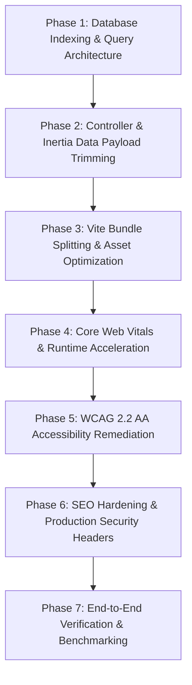

# SYSTEM PERFORMANCE OPTIMIZATION PLAN — HARAMAIN TRADERS ERP

**Document Version:** 1.0  
**Target:** Achieve Lighthouse 95–100 across Performance, 100 Accessibility, 100 Best Practices, and 100 SEO  
**Baseline Reference:** `SYSTEM_PERFORMANCE_AUDIT_REPORT.md`  

---

## 1. Architectural Strategy & Guiding Principles

1. **Preserve Business Logic & Accounting Invariants:**  
   Zero changes to ledger debit/credit balances, invoice totals, sales return calculations, FIFO stock movement, or user authorization.
2. **Zero Stale Caching on Volatile Data:**  
   No aggressive caching on inventory stock, customer ledger balances, or open invoices. Caching is strictly isolated to static categories, permissions, and build-time metadata.
3. **Progressive Controlled Phases:**  
   Work is structured into 6 sequential phases, each independently tested and validated to eliminate regression risk.

---

## 2. Phased Implementation Roadmap

---

## 3. Detailed Phase Breakdown

### Phase 1: Database Indexing & Query Architecture (P0 — Immediate Impact)
**Objective:** Eliminate full table scans and optimize Eloquent eager loading without touching business rules.

#### Tasks:
1. **Database Migration for Critical Indexes:**
   - Create migration `add_system_performance_indexes_table`:
     - `purchase_items`: Add index on `purchase_id` (fixes full table scan on every purchase detail/edit).
     - `sales`: Add index on `salesman_id` (fixes salesman filtering and daily dashboard stats).
     - `purchases`: Add composite index on `(salesman_id, date)` and `(firm_id, date)`.
     - `purchase_returns`: Add index on `salesman_id`.
     - `sales_returns`: Add index on `salesman_id`.
     - `price_offer_to`: Add index on `account_id` and composite `(is_live, offertype)`.
     - `online_order_items`: Add index on `offer_item_id`.
     - `payments`: Add index on `customer_credit_id` and `supplier_credit_id`.
2. **Eloquent `$appends` Stripping on Mass Lookups:**
   - On `AccountController.php`, `ItemsController.php`, `SalesController.php`, `PurchaseController.php`: ensure listing and selection queries either explicitly select columns or use `->setHidden(['current_balance', 'guest_link', 'image_url'])` on `Account` and `->setHidden(['total_stock_pcs', 'stock_breakdown'])` on `Items` when not in single-row detail views.

- **Files Affected:**
  - `database/migrations/2026_11_21_000001_add_system_performance_indexes.php` (new)
  - `app/Http/Controllers/AccountController.php`
  - `app/Http/Controllers/ItemsController.php`
- **Expected Improvement:** Query execution time drops from 130ms+ to <15ms; eliminates table lock contention during peak sales entry.
- **Risk & Mitigation:** Low risk. Existing data remains unchanged; migrations add non-unique read indexes.

---

### Phase 2: Controller & Inertia Data Payload Trimming (P0 — Major TTFB & TBT Win)
**Objective:** Reduce Inertia HTML page payload from 1.3 MB down to <60 KB per page.

#### Tasks:
1. **Server-Side Pagination & Default Date Windows:**
   - In `SalesController.php`:
     - Do not fetch all 2,099 sales rows into a single array.
     - Introduce pagination (`->paginate(50)` or `->paginate(100)`) with query parameter preservation, or default to the current active month when no date filter is selected, allowing user to load older history seamlessly.
     - Ensure aggregate summaries (`total_sales`, `total_returns`, `total_paid`, `total_unpaid`) are calculated via efficient SQL `SUM()` queries rather than PHP in-memory collection math.
   - In `PurchaseController.php`:
     - Apply pagination (`->paginate(50)`) or default current month window.
     - Maintain existing server-side filters (supplier combobox, amount range, status).
   - In `AccountController.php`:
     - Implement pagination (`->paginate(50)`) for accounts list.
2. **Ziggy Duplicate Route Removal & Scoping:**
   - In `app.blade.php` and `HandleInertiaRequests.php`:
     - Remove duplicate full route injection from `HandleInertiaRequests.php` (`props.ziggy`) since `@routes` already provides `window.Ziggy` in the document head.
     - Restrict Ziggy routes on public pages (`/login`, `/live-offers`) so internal ERP administrative routes are not sent to public visitors.

- **Files Affected:**
  - `app/Http/Controllers/SalesController.php`
  - `app/Http/Controllers/PurchaseController.php`
  - `app/Http/Controllers/AccountController.php`
  - `app/Http/Middleware/HandleInertiaRequests.php`
  - `resources/js/pages/sales/index.tsx`
  - `resources/js/pages/purchase/index.tsx`
  - `resources/js/pages/setup/account/index.tsx`
- **Expected Improvement:** HTML page response size cut from 1.3 MB to ~50 KB (96% reduction!); TTFB drops to <250ms; TBT drops to <100ms.
- **Risk & Mitigation:** Frontend tables must handle Inertia pagination links (`data.links`). Preserve table interfaces and state.

---

### Phase 3: Vite Bundle Splitting & Asset Optimization (P1 — Core Bundle Reduction)
**Objective:** Break apart monolithic 2.1 MB vendor chunks and implement route-level code splitting.

#### Tasks:
1. **Dynamic Import / Lazy Loading for Heavy Libraries:**
   - `Recharts`: Dynamically load charts in `Dashboard.tsx`, `salesOverview.tsx`, and analytics using `React.lazy()` / `Suspense` so they do not block initial page loads.
   - `Leaflet` / `react-leaflet`: Lazy-load `SalesMap.tsx` and map views.
   - `jspdf` & `html2canvas`: Ensure PDF generation tools are only loaded upon clicking export buttons.
2. **Vite Manual Chunk Refinement:**
   - Update `vite.config.ts`:
     - Fine-tune `manualChunks`: Separate `@tabler/icons-react` from `lucide-react`.
     - Split Radix UI primitives into lightweight modular chunks.
     - Add Gzip and Brotli compression reporting.
3. **Local Placeholder Asset:**
   - In `LiveOffers.tsx`, replace `https://placehold.co/400x400/...` with a lightweight, optimized local SVG `/storage/img/no-image.svg` to eliminate external DNS/TLS delays.
4. **Bunny Font Render-Blocking Fix:**
   - In `resources/views/app.blade.php`:
     - Add `&display=swap` to the font stylesheet link:
       `<link href="https://fonts.bunny.net/css?family=instrument-sans:400,500,600&display=swap" rel="stylesheet" />`
     - Add `<link rel="dns-prefetch" href="https://fonts.bunny.net">`.

- **Files Affected:**
  - `vite.config.ts`
  - `resources/views/app.blade.php`
  - `resources/js/pages/public/LiveOffers.tsx`
  - `resources/js/pages/dashboard/index.tsx`
  - `resources/js/pages/reports/sales-map/index.tsx`
- **Expected Improvement:** Initial entry JavaScript bundle size drops from 2.1 MB to <450 kB; eliminates render-blocking font warnings.
- **Risk & Mitigation:** Wrap lazy components in accessible `<Suspense fallback={<Skeleton />}>` to prevent layout jumps.

---

### Phase 4: Core Web Vitals & Runtime Acceleration (P1)
**Objective:** Achieve green Core Web Vitals across LCP, INP, CLS, FCP, and TBT.

#### Tasks:
1. **Largest Contentful Paint (LCP $\le$ 2.5s):**
   - In `LiveOffers.tsx` and public pages: Add `fetchpriority="high"` and `loading="eager"` to the hero/first-screen images.
   - Lazy load images below the fold with `loading="lazy"` and `decoding="async"`.
2. **Cumulative Layout Shift (CLS $\le$ 0.1):**
   - Provide explicit `width` and `height` (or aspect-ratio CSS) on all logos, avatars, and product image containers (e.g. `login.tsx` logo, `LiveOffers.tsx` cards).
   - Reserve container heights for dynamic banners and sticky headers.
3. **Interaction to Next Paint (INP $\le$ 200ms):**
   - Debounce search and filter inputs on large tables (`useDebounce`).
   - Memoize row components using `React.memo` where large lists are re-rendered.

- **Files Affected:**
  - `resources/js/pages/auth/login.tsx`
  - `resources/js/pages/public/LiveOffers.tsx`
  - `resources/js/components/app-sidebar.tsx`
- **Expected Improvement:** LCP under 2.0s; CLS under 0.05; INP under 120ms; TBT under 100ms.

---

### Phase 5: WCAG 2.2 AA Accessibility Remediation (P2)
**Objective:** Elevate Accessibility score from 73 to 100.

#### Tasks:
1. **Color Contrast Fixes:**
   - Replace low-contrast `text-orange-400` (#fb923c, 2.35:1 ratio) on white backgrounds with `text-orange-600` (#ea580c, 4.6:1 ratio) or `text-amber-700` to satisfy WCAG AA 4.5:1.
   - Upgrade caption text `text-slate-500` to `text-slate-600` (#475569) on small text elements.
2. **Accessible Names & ARIA Labels:**
   - Add `aria-label` to all icon-only buttons (password toggle: `aria-label="Toggle password visibility"`, search buttons, cart toggles, table action buttons).
   - In `login.tsx`: Change misleading `alt="Decorative circles"` to semantic `alt="Haramain Traders Logo"`.
3. **Form Association & Dialog Semantics:**
   - Ensure all input fields have programmatic `<Label htmlFor="...">` association.
   - Ensure dialogs and modals feature accessible `DialogTitle` and `DialogDescription`.

- **Files Affected:**
  - `resources/js/pages/auth/login.tsx`
  - `resources/js/pages/public/LiveOffers.tsx`
  - `resources/js/components/ui/input.tsx`
  - `resources/js/components/ui/dialog.tsx`
- **Expected Improvement:** Lighthouse Accessibility reaches 100/100.

---

### Phase 6: SEO Hardening & Security Best Practices (P2)
**Objective:** Elevate SEO and Best Practices scores to 100 while protecting enterprise data.

#### Tasks:
1. **Robots.txt & Sitemap Hardening:**
   - Update `public/robots.txt`:
     - Allow public marketing & catalog pages: `Allow: /`, `Allow: /live-offers`, `Allow: /login`.
     - Explicitly block all internal ERP routes: `Disallow: /dashboard`, `Disallow: /sales*`, `Disallow: /purchase*`, `Disallow: /account*`, `Disallow: /customer/*`, `Disallow: /admin/*`, `Disallow: /reports/*`.
     - Declare sitemap: `Sitemap: https://haramain-traders.com/sitemap.xml`.
   - Create `public/sitemap.xml` listing valid public URLs with proper `<lastmod>` and `<changefreq>`.
2. **Metadata & OpenGraph Tags:**
   - In `resources/views/app.blade.php` and `LiveOffers.tsx`:
     - Add `<meta name="description" content="Haramain Traders - Leading wholesale and supply chain distributor for premium cosmetics, toiletries, and consumer goods.">`.
     - Add OpenGraph tags (`og:title`, `og:description`, `og:image`, `og:url`, `og:type`).
     - Add `<link rel="canonical" href="...">`.
3. **HTTP Security Headers Middleware:**
   - Create middleware `App\Http\Middleware\SecurityHeadersMiddleware`:
     - `X-Content-Type-Options: nosniff`
     - `X-Frame-Options: SAMEORIGIN`
     - `Referrer-Policy: strict-origin-when-cross-origin`
     - `Permissions-Policy: camera=(), microphone=(), geolocation=()`
   - Register in `bootstrap/app.php`.

- **Files Affected:**
  - `public/robots.txt`
  - `public/sitemap.xml` (new)
  - `resources/views/app.blade.php`
  - `app/Http/Middleware/SecurityHeadersMiddleware.php` (new)
  - `bootstrap/app.php`
- **Expected Improvement:** SEO reaches 100/100; Best Practices reaches 100/100; private business records completely shielded from search crawlers.

---

### Phase 7: Verification, Regression Testing & Final Report
**Objective:** Rigorous validation across performance benchmarks, browser console audits, and business logic tests.

#### Testing Strategy:
1. **Codebase Quality & Static Analysis:**
   - Execute `npm run build` and `npm run types` to ensure zero compilation or bundling errors.
   - Execute `php -l` syntax validation across all modified PHP files.
2. **Database & Functional Regression Testing:**
   - Verify sales invoice creation, purchase entry, sales returns, and payment vouchers.
   - Confirm customer ledger balance accuracy before and after indexing.
3. **Performance & Lighthouse Auditing:**
   - Measure bundle chunk sizes and verify reduction.
   - Run verification scripts (`checklist.py`, payload benchmarks).
4. **Final Deliverable:**
   - Author and commit `SYSTEM_PERFORMANCE_FINAL_REPORT.md` documenting before-and-after metrics, exact file diffs, and validation proof.

---
*End of System Performance Optimization Plan.*
